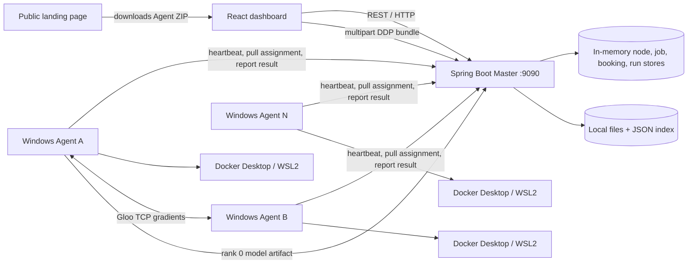

# IdleGrid — Project and Technical Guide

IdleGrid is a student-built distributed computing prototype for a campus computer lab. A Spring Boot **Master** tracks available lab PCs, accepts compute work, and assigns it to **Agents** installed on the PCs. Agents run the work in Docker containers with CPU and memory limits. The web dashboard shows cluster capacity, submits jobs, manages shared files, and provides a separate multi-node PyTorch DistributedDataParallel (DDP) training workflow.

This document describes the implementation in this repository, including its current boundaries. It is intended as a technical reference for the project report, demonstration, and presentation. Features described as future work are not represented as already implemented.

## 1. Project at a glance

| Area | Current implementation |
|---|---|
| Master/backend | Java 17, Spring Boot 3.3.4, REST API on port 9090 |
| Agent | Java 17 background process; packaged for Windows as a portable ZIP |
| Worker runtime | Docker Desktop using its WSL2 backend; jobs run in Linux containers |
| Dashboard | React 18, Vite, Tailwind CSS; development server on port 5173 |
| Public landing page | Separate React/Vite site that serves the Windows Agent ZIP |
| Node/job/booking/run control data | In-memory Java stores; restart clears this control state |
| Shared files | Master filesystem plus JSON index and up to two worker replicas |
| Scheduling | First-fit for ordinary work; atomic 2–3 node placement for DDP runs |
| Discovery | JSONBin rendezvous first, then UDP discovery and local-subnet scan fallback |
| Security scope | Prototype for a trusted lab network; no authentication or authorization layer |

The code is organized as a **centralized Master with worker Agents**, rather than a decentralized or gossip-based scheduler. DDP uses PyTorch's Gloo backend over TCP and requires direct peer reachability between selected PCs.

## 2. Motivation and goals

Lab PCs often sit underused while students need compute for scripts and machine-learning experiments. IdleGrid's goal is to make this spare capacity available through one interface and to bound the resources a job can consume on any one PC.

The implemented demonstration focuses on these outcomes:

1. Agents join the Master and report node identity, IP address, free CPU, RAM, and disk.
2. The dashboard shows live capacity across online nodes.
3. Users submit containerized commands with CPU and memory requests; the Master queues and places work.
4. Agents pull assignments, start Docker containers, capture output, and report completion.
5. Users can upload a shared file, receive a random access key, and retrieve that file later.
6. A separate training page can launch a DDP-aware image-classification script across 2–3 lab PCs and offer rank zero's model artifact.

The broader design context and research motivation are in [`docs/PROJECT_CONTEXT.md`](docs/PROJECT_CONTEXT.md). That document includes ideas and a roadmap that go beyond the implementation described here; PostgreSQL, MinIO, DRF, checkpointing, and a decentralized scheduler are not current components.

## 3. System architecture



### 3.1 Master/backend

The Master is the control plane. It owns the REST endpoints, the in-memory node/job/booking/training-run stores, first-fit job scheduling, shared-file metadata, and training-group placement. Its HTTP port defaults to **9090**. A small UDP service listens on **9091** for local Agent discovery.

The Master does not execute student commands itself. An Agent assigned a job starts the container on its own PC.

### 3.2 Agent

An Agent runs on each worker PC. It has scheduled loops for heartbeats, job polling, idle detection, container monitoring, and file-replica polling. It keeps a stable node ID in `.node_id` unless `node.id` is explicitly set in `agent.properties`.

The current distributable is a portable Windows ZIP containing the Agent JAR, launcher, configuration, setup script, quick-start guide, and training-worker Dockerfile. The public landing page provides that ZIP. It does not currently provide a built-in Agent image or a guaranteed prebuilt PyTorch image inside the ZIP.

### 3.3 Dashboard and public site

The internal dashboard is the operational UI, with routes for overview, booking, terminal-style command submission, jobs, shared storage, and distributed training. In development, Vite proxies `/api` to the Master (default `http://localhost:9090`). For a production build, set `VITE_MASTER_URL` to the Master address reachable by the users' browsers.

The separate public landing page is a simple download and onboarding site. It is not the internal dashboard and does not proxy API requests.

## 4. Important implementation choices

### 4.1 No database in this milestone

Node, job, booking, and DDP run records live in process memory. Restarting the Master clears those records. Shared file contents and the file metadata index are persisted on the Master filesystem, but that does not make job/run control data persistent.

### 4.2 First-fit job placement

The scheduler checks online nodes as returned by the in-memory node registry, subtracts CPU/RAM reserved by active assignments, and assigns a queued job to the first node with enough reported capacity. Registry iteration order is not a stable scheduling policy. If a job specifies `targetNodeId`, the scheduler only considers that node. The scheduler runs a pass immediately on ordinary job submission and every three seconds. A heartbeat older than 15 seconds marks the node offline.

The ordinary scheduler is a simple prototype policy. It is not DRF, does not optimize data locality, and does not promise fairness across users.

### 4.3 Resource limits and co-tenancy

The Agent launches containers with Docker `--cpus` and `--memory` limits. The Windows setup script configures Docker Desktop's WSL engine and Docker VM resource settings; it calculates an approximate memory allocation based on host RAM (about 75%, rounded to whole GB, with a 2 GB minimum) and uses the host logical CPU count. Container limits still apply per job.

The Agent also detects keyboard/mouse inactivity on Windows. It starts in `ACTIVE`, changes to `IDLE` after the configured threshold (default 300 seconds), and evicts a running job on an `IDLE → ACTIVE` transition. Eviction kills the container and reports a failed job; it does not checkpoint or resume it. The current Master heartbeat DTO does not store the extra `idleState` field emitted by the Agent, so the scheduler places using online status and available capacity rather than an idle-state requirement. Resource capping and the Agent's return-to-use eviction are the current safeguards; they are not a guarantee of zero perceived impact on every PC.

### 4.4 Ordinary jobs and network modes

Ordinary containers use Docker's default bridge networking and publish exposed ports with `-P`. DDP worker containers request host networking so the PyTorch processes can open peer-to-peer TCP connections. That DDP mode requires Docker Desktop 4.34 or newer with host networking enabled in Docker Desktop settings.

### 4.5 Shared storage model

An upload is first stored on the Master and indexed by a random UUID access key. When online worker disks have capacity, the Master queues up to two replicas. Agents poll for tasks, download the bytes from the Master, write them under their local storage directory, and acknowledge completion. The Master tracks replica node IDs and reduces its reported free disk capacity when a replica is recorded.

The shared-storage dashboard displays online worker disk capacity, Master disk capacity, files, status, and replica counts. A file's random key is a bearer capability: anyone who has the key can download the content. There is no user account ownership or per-user quota in this version.

### 4.6 DDP training model

The separate training workflow is CPU-first PyTorch DDP:

1. The browser uploads one ZIP containing a DDP-aware Python entrypoint and data.
2. The Master validates the ZIP, reserves 2 or 3 online PCs with sufficient CPU/RAM and no active job, and creates one normal Agent job per rank.
3. Each selected Agent downloads the same ZIP from the Master and launches one `torchrun` rank in a host-networked container.
4. The user's script partitions samples, typically with `DistributedSampler`, and DDP synchronizes gradients during training.
5. Rank zero saves the model and uploads it to the Master; the dashboard exposes a download link.

**IdleGrid does not split the uploaded ZIP into separate physical data files.** Each rank receives the same bundle. The training script performs sample-level partitioning. DDP combines training through synchronized gradient updates, rather than a later merge of independent model files.

The repository example is [`examples/distributed-image-training/train.py`](examples/distributed-image-training/train.py). A ready-to-upload synthetic dataset bundle is [`examples/distributed-image-training/idlegrid-ddp-image-demo.zip`](examples/distributed-image-training/idlegrid-ddp-image-demo.zip); it contains circles, squares, and triangles for a small demonstration, not real-world recognition data.

## 5. Main user workflows

### 5.1 Join a PC to the grid

1. Download and extract the Agent ZIP from the public landing page.
2. Install Java 17+ and Docker Desktop with its WSL2 backend.
3. If needed, run `setup.ps1` as Administrator to prepare WSL2/Docker Desktop settings.
4. Make sure the Master is running and reachable on TCP port 9090.
5. Leave `master.url=auto` in `agent.properties` for automatic discovery, or set `master.url=http://<master-ip>:9090` manually.
6. Start `run-agent.bat`. Check the Agent log and the dashboard for its heartbeat.

Auto-discovery tries the public JSONBin rendezvous record first. The Master updates the public bin with the URL derived from its routed LAN address unless `rendezvous.master-url` is configured. If rendezvous lookup fails, the Agent falls back to UDP discovery on port 9091 and then a local `/24` TCP scan. UDP broadcast and subnet scans can be blocked by VLANs or Wi-Fi client isolation; manual `master.url` is the fallback.

### 5.2 Submit a regular job

From the Jobs page or terminal-style page, enter a command and CPU/RAM requests. The Master creates a `QUEUED` job, immediately tries first-fit placement, and returns its status. The assigned Agent pulls the job, obtains the requested Docker image if it is not already local, starts the container, captures logs, waits for exit, and reports `DONE` or `FAILED` with the output.

The terminal-style page is a **batch command bridge**, not a live interactive shell. It shows the job output after completion. Live terminal stdin/stdout streaming is not implemented.

The Book Resources page lets a user target a specific online PC and request a time-limited SSH session. The backend builds an `sshd` plus sleep command for a requested duration, capped at 24 hours. The booking REST API also stores simple booking records in memory; these are not persisted calendar reservations.

### 5.3 Upload and retrieve a shared file

1. Open **Storage** and upload a file.
2. The Master saves the bytes and returns a random `key`.
3. Copy the key or use the page's download link. The key can be used later at `GET /storage/files/{key}/content`.
4. If worker disk space is available, the Master schedules up to two replicas and Agents acknowledge them.

Default upload/request size is limited by Spring to 100 MB. Master files and the JSON index live under `./storage` by default; override with `idlegrid.storage.directory`.

### 5.4 Run the DDP image example

On each selected Agent PC:

- Enable Docker Desktop host networking (4.34+) under **Settings → Resources → Network**.
- Allow TCP reachability among selected PCs on the lab LAN, including the DDP coordinator's port 29500 and access to the Master backend.
- Ensure the PyTorch CPU worker image exists locally. The dashboard uses `ghcr.io/avadhutmali/idlegrid-pytorch-cpu:latest`. GHCR publication must be verified before relying on `docker pull`; if the tag is not yet available publicly, build the Dockerfile on every Agent using the same image tag:

```powershell
# Run from the extracted Agent directory

docker build -t ghcr.io/avadhutmali/idlegrid-pytorch-cpu:latest `
  -f training-worker/Dockerfile training-worker
```

Then open **Distributed training**, upload the example ZIP, and submit:

```text
train.py --epochs 2 --batch-size 32
```

Select 2 or 3 workers and set per-PC CPU/RAM requests. All selected nodes need to be online and have enough free capacity. A worker failure or eviction fails the DDP group; there is no checkpoint-based recovery.

**GHCR status note:** the publishing workflow exists, but a public pull of the image tag/digest has not been verified in this project snapshot. A public package page alone is not proof that a `latest` image manifest has been pushed. Confirm the Actions publish job succeeds and `docker pull ghcr.io/avadhutmali/idlegrid-pytorch-cpu:latest` works before using the remote image. A digest reference only works after that exact manifest digest has been uploaded.

## 6. REST API reference

All endpoints are served by the Master on port 9090. There is no authentication middleware. JSON examples are schematic; Java record fields and defaults in the code are authoritative.

### 6.1 Nodes

| Method and path | Caller | Purpose |
|---|---|---|
| `POST /nodes/heartbeat` | Agent | Create/update node capacity and last-seen time |
| `GET /nodes/summary` | Dashboard | List known nodes and current reported capacity/status |

Heartbeat body fields: `nodeId`, `ip`, `sshCommand`, `cpuTotal`, `cpuFree`, `ramTotalMb`, `ramFreeMb`, `diskTotalMb`, `diskFreeMb`, `status`. The node is marked offline when the status is `OFFLINE`; stale online heartbeats expire after 15 seconds.

### 6.2 Jobs and Agent assignment

| Method and path | Caller | Purpose |
|---|---|---|
| `POST /jobs/submit` | Dashboard/test client | Create a job and immediately attempt scheduling |
| `GET /jobs` | Dashboard | List jobs |
| `GET /jobs/{id}/status` | Dashboard | Read one job's status and result |
| `POST /jobs/{id}/running` | Agent | Report a started container and SSH port |
| `POST /jobs/{id}/complete` | Agent | Report result and success/failure |
| `GET /agent/{nodeId}/assignment` | Agent | Pull the next assignment; `204` means none |

Job submit body:

```json
{
  "cpuReq": 1.0,
  "ramReqMb": 512,
  "command": "echo hello from idlegrid",
  "targetNodeId": null,
  "durationMinutes": 0
}
```

`targetNodeId` is optional. If `durationMinutes` is positive, the backend constructs the SSH session command and caps the duration at 1440 minutes. Job states are `QUEUED`, `ASSIGNED`, `RUNNING`, `DONE`, and `FAILED`.

### 6.3 Bookings

| Method and path | Caller | Purpose |
|---|---|---|
| `GET /bookings` | Dashboard | List in-memory booking records |
| `POST /bookings` | Dashboard | Create a record for an online node |
| `DELETE /bookings/{id}` | Dashboard | Remove a record |

Booking fields: `nodeId`, `requester`, `startAt`, `endAt`, `cpuReq`, and `ramReqMb`. The current Book Resources UI's SSH session path submits a target-node job; this endpoint does not implement durable reservation scheduling.

### 6.4 Shared storage

| Method and path | Caller | Purpose |
|---|---|---|
| `GET /storage/summary` | Dashboard | Master/worker disk totals, free space, file count, replica target |
| `GET /storage/files` | Dashboard | List metadata and access keys |
| `POST /storage/files` | Dashboard | Multipart field `file`; store file and return metadata/key |
| `GET /storage/files/{key}/content` | User/browser | Download by access key |
| `GET /agent/{nodeId}/storage/assignment` | Agent | Pull a queued replica task or receive `204` |
| `GET /agent/storage/{key}/content` | Agent | Download bytes for replica placement |
| `POST /agent/{nodeId}/storage/{key}/complete` | Agent | Acknowledge replica with `{"success":true}` |

### 6.5 Distributed training

| Method and path | Caller | Purpose |
|---|---|---|
| `POST /distributed-training/runs` | Dashboard | Multipart submission: `bundle`, `command`, `workers`, `cpuReq`, `ramReqMb`, `image`, `outputFile` |
| `GET /distributed-training/runs` | Dashboard | List runs in the current Master process |
| `GET /distributed-training/runs/{runId}` | Dashboard | Run state, coordinator, per-rank states and output tails |
| `GET /distributed-training/runs/{runId}/bundle` | Worker container | Download the submitted ZIP |
| `POST /distributed-training/runs/{runId}/artifact` | Rank zero container | Multipart `file` upload of final model |
| `GET /distributed-training/runs/{runId}/artifact` | Dashboard/user | Download completed artifact |

Submission currently supports 2–3 workers, positive CPU requests, at least 512 MB RAM per worker, a Python entrypoint, and a safe output filename such as `model.pt`. The upload is capped at 100 MB by Spring; the ZIP validator caps expanded data at 1 GB and rejects unsafe paths and very large entry counts. Runs and bundles are held on the Master filesystem (temp directory by default), while run/job control state remains in memory.

## 7. Configuration and ports

### Backend

| Setting | Default | Description |
|---|---|---|
| `server.port` | `9090` | HTTP API port |
| `rendezvous.jsonbin.bin-id` | Project bin ID in `application.properties` | Public JSONBin used for Master URL discovery |
| `rendezvous.master-url` / `JSONBIN_MASTER_URL` | blank | Optional explicit Master URL to publish/use |
| `JSONBIN_BIN_ID` | Project bin ID | Environment override for bin ID |
| `idlegrid.storage.directory` | `./storage` | Persistent file contents and `index.json` |
| `idlegrid.training.directory` | OS temp `idlegrid-training-runs` | DDP bundles and artifacts |
| Multipart maximum | `100MB` | Spring upload and request limit |

The backend also listens on UDP **9091** for `IDLEGRID_DISCOVER_MASTER` and responds with its HTTP port.

### Agent

`agent.properties` in the Agent working directory overrides bundled defaults. Important fields include:

| Setting | Default | Description |
|---|---|---|
| `master.url` | `auto` | Master discovery or explicit URL such as `http://192.168.1.25:9090` |
| `rendezvous.jsonbin.bin-id` | Project bin ID | Public rendezvous record read by Agents |
| `node.id` | blank | Blank means load/generate and persist `.node_id` |
| `heartbeat.interval.seconds` | `3` | Node heartbeat period |
| `job.poll.interval.seconds` | `5` | Assignment poll period |
| `idle.threshold.seconds` | `300` | Input inactivity required to enter IDLE |
| `idle.check.interval.seconds` | `10` | Idle-state check period |
| `docker.default.image` | `ghcr.io/avadhutmali/idlegrid-ubuntu-worker:latest` | Default image for ordinary jobs |
| `workspace.dir` | `./workspace` | Per-job working directories mounted at `/workspace` |
| `storage.dir` | `./storage` | Local replicas and disk-capacity measurement |
| `log.dir` | `./logs` | Agent logs, including session logs |

### Ports and network reachability

| Port | Protocol | Use |
|---:|---|---|
| 9090 | TCP | Master REST API |
| 9091 | UDP | Local Master discovery |
| 29500 | TCP | Default DDP rendezvous/coordinator port |

Agents must reach the Master. For multi-node DDP, selected worker containers must also reach one another directly. Campus Wi-Fi client isolation, VLANs, Windows Firewall, or Docker Desktop host-networking settings can prevent this even when heartbeats work.

## 8. Build and run locally

### 8.1 Start the Master

Requires Java 17+ and Maven (or the included wrapper).

```bash
cd backend
./mvnw spring-boot:run
```

On Windows Command Prompt or PowerShell:

```powershell
cd backend
.\mvnw.cmd spring-boot:run
```

The API is at `http://localhost:9090`. To build a JAR, run `./mvnw package` (or `mvnw.cmd package`).

### 8.2 Start the dashboard

Requires Node.js and npm.

```bash
cd frontend
npm install
npm run dev
```

Open `http://localhost:5173`. By default, the Vite `/api` proxy targets `http://localhost:9090`. Set `VITE_MASTER_URL` in a local environment file when the backend is elsewhere. Do not commit credentials or private runtime settings in `.env` files.

### 8.3 Start an Agent

Requires Java 17+ and Docker Desktop running with WSL2. Extract the portable ZIP and run `run-agent.bat`. To manually set the Master, edit the extracted `agent.properties` next to the launcher and set:

```properties
master.url=http://<master-pc-ip>:9090
```

For the Windows setup helper, run `setup.ps1` in an elevated PowerShell session only after reviewing what it changes. It enables/configures WSL and Docker Desktop settings. Restart/reboot may be necessary for Windows features or Docker settings to take effect.

### 8.4 Build the DDP worker image locally

From the extracted Agent directory, build the exact image tag the dashboard requests:

```powershell
docker build -t ghcr.io/avadhutmali/idlegrid-pytorch-cpu:latest `
  -f training-worker/Dockerfile training-worker
```

A locally built image with this tag lets the Agent's image inspection succeed without contacting GHCR. The Agent ZIP includes the Dockerfile and its README, not the built image layers.

## 9. Repository map

```text
.
├── README.md                         # Short project overview and quick links
├── DETAILED_README.md                # This full implementation/report guide
├── AGENTS.md                         # Repository guidance for coding assistants
├── docs/PROJECT_CONTEXT.md           # Motivation, research context, and roadmap notes
├── backend/
│   ├── src/main/java/...             # Spring controllers, scheduler, services, stores
│   ├── src/main/resources/application.properties
│   ├── storage/                      # Runtime file store/index (created at runtime)
│   ├── README.md
│   └── HOW_TO_RUN.md
├── agent/
│   ├── src/main/java/...             # Agent loops, Docker executor, discovery, storage
│   ├── training-worker/Dockerfile    # CPU PyTorch/Gloo runtime image recipe
│   ├── setup.ps1                     # Windows WSL/Docker setup helper
│   ├── package.bat                   # Portable Agent ZIP builder
│   └── installer/                    # Windows installer build scripts and files
├── frontend/
│   ├── src/pages/                    # Overview, booking, jobs, storage, DDP screens
│   ├── src/api/idleGridApi.js        # Browser-to-Master API client
│   └── vite.config.js                # Local API proxy and port 5173
├── public-landing-page/
│   ├── src/                          # Public download/onboarding site
│   └── public/downloads/             # Static Agent ZIP published with the site
├── examples/distributed-image-training/
│   ├── train.py                      # Example Gloo DDP image classifier
│   └── idlegrid-ddp-image-demo.zip   # Synthetic sample bundle
└── .github/workflows/
    ├── release.yml                   # Windows Agent ZIP/setup release workflow
    └── publish-training-image.yml    # GHCR DDP image build/publish workflow
```

## 10. CI, deployment, and downloadable artifacts

### Agent release

`.github/workflows/release.yml` runs on pushes to `main` and on manual dispatch. On a Windows runner it packages the Agent and compiles the Windows setup executable, then attaches release artifacts to GitHub Releases. The public landing page currently links to a static Agent ZIP under `public-landing-page/public/downloads/`; it must be updated/rebuilt when the downloadable archive changes.

### GHCR DDP image

`.github/workflows/publish-training-image.yml` is configured to build and push `ghcr.io/avadhutmali/idlegrid-pytorch-cpu:latest` when the training-worker Dockerfile/context or workflow changes on `main`. It requests `packages: write`. For an existing GHCR package with granular permissions, the repository may also need **Write** under the package's **Manage Actions access** setting. The package must contain a pushed image manifest before Agents can pull it; public visibility by itself does not create the tag.

### Vercel

The repository's `vercel.json` specifies a Vite build (`npm install`, `npm run build`, output `dist`). The Vercel project root must point to the intended Vite app directory. The public landing page and internal dashboard are separate frontend projects; confirm the Vercel root/build settings for the one being deployed.

## 11. Current limitations and risks

- **Prototype control state:** nodes, jobs, bookings, and DDP run state disappear when the Master restarts. There is no database or job checkpointing.
- **No authentication:** dashboard and API calls are open. Treat the network as trusted; do not expose the Master publicly as-is.
- **Bearer file keys:** possession of a file key grants download access. Keys are shown in the UI and there are no user accounts/ownership controls.
- **Storage durability:** the Master primary copy and JSON index persist locally, but worker replicas are best-effort. There is no repair/rebalance guarantee for every worker-disk failure or Master-disk loss.
- **Capacity estimates:** CPU, RAM, and disk are sampled periodically and may change between heartbeat and placement. They are estimates, not reservations enforced by the host OS at the scheduler level.
- **Job failure:** ordinary jobs can be requeued when a node heartbeat expires; DDP worker loss fails the run. No checkpoint/restart protocol exists.
- **No live interactive terminal:** output is returned after job completion; interactive input and streamed output are not implemented.
- **DDP prerequisites:** each PC must have the same compatible image and direct TCP reachability. Docker Desktop host networking must be enabled. A single-node successful job does not prove multi-node networking works.
- **DDP script requirements:** the user's Python code must initialize `torch.distributed`, wrap the model with DDP, shard examples (for example with `DistributedSampler`), and save the expected rank-zero artifact.
- **GHCR availability:** the package may be public while a desired tag/digest is absent. Confirm the image publishing workflow is green and test an anonymous pull.
- **Lab-PC administration:** installing an Agent, enabling Windows features, modifying Docker Desktop settings, and opening firewall ports require appropriate lab/admin approval.
- **Network locality:** the default JSONBin record publishes a private LAN address. Agents outside that routed network cannot use it; off-campus use requires an explicitly reachable Master/VPN/tunnel, which is outside this prototype's guarantees.

## 12. Suggested demonstration plan

1. Start the Master and show the API port and successful startup logs.
2. Start Agents on two or three lab PCs; show node IDs, IPs, and heartbeat-updated CPU/RAM/disk.
3. Submit a short regular command with a low CPU/RAM cap. Show `QUEUED → ASSIGNED → RUNNING → DONE` and its captured output.
4. Upload a file in Storage. Show the access key, replica count, and download by key.
5. Upload the synthetic DDP ZIP on the Distributed training page. Show the gang placement, worker ranks, CPU/Gloo logs, and rank-zero model download.
6. In a separate controlled run, demonstrate Agent behavior when a user returns from idle and discuss the resulting job failure/eviction rather than claiming checkpointed continuation.
7. Report measured outcomes only: node count, placement result, job duration, selected CPU/RAM limits, DDP run status, and whether rank zero produced an artifact.

Use a small model and small dataset for a classroom demo. A dataset or model that is too large can exceed the 100 MB upload limit, 1 GB expanded ZIP limit, requested RAM, or available lab network bandwidth.

## 13. Report and presentation outline

A project report or slide deck can follow this sequence:

1. **Problem statement:** underused campus compute and constrained student hardware.
2. **Objectives and scope:** reuse lab PCs, cap per-job resources, provide centralized monitoring, prototype shared storage, demonstrate DDP.
3. **Architecture:** Master, Agents, Docker/WSL2, dashboard, file store, network paths.
4. **Technology choices:** Spring Boot/Java, React/Vite, Docker, WSL2, JSONBin rendezvous, local JSON file index, PyTorch Gloo/DDP.
5. **Node and job lifecycle:** heartbeat → scheduling → Agent pull → container execution → completion.
6. **Resource management:** reported capacity, first-fit placement, Docker CPU/RAM limits, WSL/Docker host configuration, user-return eviction behavior.
7. **Shared storage:** Master primary file, access key, worker replica tasks, metadata/status.
8. **Distributed training:** one rank per PC, identical bundle distribution, `DistributedSampler`, gradient synchronization, rank-zero artifact.
9. **Implementation/demo evidence:** screenshots, logs, command examples, measured observations, and known failures.
10. **Limitations:** no auth/database/checkpointing, best-effort replicas, network dependencies, pending image publication if unresolved.
11. **Future work:** persistent control database, auth/quotas, fault-tolerant training/checkpoints, improved scheduling, stronger isolation/monitoring—clearly labelled future work.

## 14. Glossary

- **Master:** central Spring Boot service that receives API requests and coordinates work.
- **Agent:** per-PC process that reports resources, polls for jobs, and controls Docker.
- **Node:** a lab PC known to the Master through Agent heartbeats.
- **Heartbeat:** periodic Agent report used to refresh node presence and capacity.
- **First-fit:** scheduler policy that chooses the first online node satisfying a job's CPU/RAM request.
- **Replica:** worker-side copy of a file whose primary is stored on the Master.
- **Rank:** one distributed PyTorch process in a DDP worker group; this prototype runs one rank per PC.
- **Gloo:** PyTorch distributed communication backend used for CPU-based collectives.
- **DistributedSampler:** PyTorch data sampler that assigns different sample indices to each rank.
- **Access key:** random file identifier; in this prototype, possession of it grants download access.
