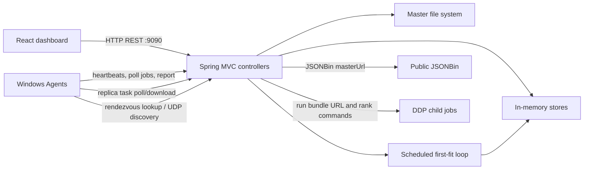

# IdleGrid Backend (Master)

This guide explains the backend as it is implemented in this repository. The backend is the central **control service** for IdleGrid: it receives Agent heartbeats, stores the current node/job state, assigns work, coordinates shared-file replicas, and launches the Master side of multi-node PyTorch training.

It is a Java 17 / Spring Boot prototype intended for demonstrations on a trusted lab network. The student client has a small configured-account login and in-memory sessions; the operator/dashboard and Agent APIs remain open on the trusted network. There is no database. The DDP concepts and training-script requirements are explained in the separate [PyTorch DDP and IdleGrid learning guide](../docs/DDP_DISTRIBUTED_TRAINING_GUIDE.md).

## 1. Responsibilities and boundaries

The backend:

- Exposes the HTTP REST API on port **9090**.
- Receives node capacity heartbeats and marks stale nodes offline.
- Queues jobs and selects an Agent node using first-fit placement.
- Serves assignment requests when Agents poll; the Master does not open a connection to push jobs.
- Records completion, failure, result text, node address, and SSH port for jobs.
- Keeps uploaded files on the Master and assigns up to two worker replicas when disk capacity allows.
- Selects 2–3 worker nodes together for a DDP run, creates one child job per rank, stores the uploaded bundle, and accepts rank zero's artifact.
- Publishes its reachable URL to a public JSONBin rendezvous bin on startup unless an explicit Master URL is configured.
- Listens on UDP port **9091** for local Agent discovery requests.

The backend does not run a submitted compute command locally. The Agent starts it inside Docker on the selected PC. For DDP, the backend coordinates jobs and file delivery; PyTorch/Gloo processes communicate directly among their worker PCs.



## 2. Backend modules

| Package / class | Responsibility |
|---|---|
| `BackendApplication` | Spring Boot entry point; enables scheduled processing |
| `controller/NodeController` | Heartbeat registration/update and node summary |
| `controller/JobController` | Job submission, listing, status, running, and completion APIs |
| `controller/AgentController` | Agent job assignment polling and storage replica protocol |
| `controller/StorageController` | File upload, metadata listing, summary, and key-based download |
| `controller/BookingController` | In-memory booking records and overlap checks |
| `controller/DistributedTrainingController` | DDP run submission, status, bundle, and artifact endpoints |
| `scheduler/SchedulerService` | Periodic stale-node detection and first-fit job assignment |
| `service/StorageService` | Master file/index persistence, replica assignment, retry and accounting |
| `service/DistributedTrainingService` | Bundle validation, gang placement, rank command creation, run/artifact state |
| `store/NodeStore`, `JobStore`, `BookingStore`, `DistributedTrainingStore` | In-memory maps for live control records |
| `config/RendezvousRegistrar` | Publishes the selected Master URL to JSONBin during startup |
| `config/UdpDiscoveryServer` | Replies to UDP Master-discovery packets on port 9091 |
| `config/CorsConfig` | Allows cross-origin HTTP requests for the prototype |

### Stores versus services

A `Store` is a simple in-process registry; it is not a disk database. A `Service` contains workflow logic that coordinates stores and the filesystem. Spring's `ConcurrentHashMap`-based stores support access from the HTTP threads and scheduled loops, but all their records are lost when the Java process restarts.

Student account hashes, per-student job history, DDP history, and uploaded-file ownership persist as JSON under the configured storage directory. DDP bundle/artifact files persist under `storage/training` by default. Active node/job/worker execution state remains in memory and active jobs/runs are marked interrupted in student history after a Master restart.

## 3. Main data objects

### Node

An Agent heartbeat creates or updates a Node identified by `nodeId`. Important fields are:

- `id`, `ip`, and optional `sshCommand`.
- `cpuTotal` and `cpuFree`, in logical cores/core equivalents.
- `ramTotalMb` and `ramFreeMb`.
- `diskTotalMb` and `diskFreeMb`, measured on the volume containing the Agent storage directory.
- `lastHeartbeat` and `status` (`ONLINE` or `OFFLINE`).

The backend trusts the values reported by Agents; these are live capacity estimates, not reserved hardware quotas by themselves.

### Job

A job holds an ID, CPU/RAM request, command, optional image, optional Docker `networkMode`, optional target node, assignment state, result, and connection fields. Job states are:

```text
QUEUED -> ASSIGNED -> RUNNING -> DONE
                              \-> FAILED
```

`DONE` and `FAILED` are terminal for the current job. Ordinary work can be requeued if the assigned node becomes stale while the job is active. DDP child jobs are marked failed on node loss because the distributed group cannot continue with a missing rank.

### Booking

Bookings are simple time-range records containing node ID, requester, start/end instants, and CPU/RAM request. They are stored in memory and checked for overlapping windows on the same node. The booking record API is separate from scheduler job placement; it is not a durable calendar or automatic capacity reservation system.

### StoredFile

A file record contains the random key, original filename, content type, byte size, creation time, replication status, and replica node IDs. Status is `REPLICATING` until two worker copies are recorded, then `AVAILABLE`. The Master always remains the primary copy.

### DistributedTrainingRun

A run record maps a run ID to the Master URL, rank-zero IP/port, worker count, Docker image, requested output filename, bundle path, worker-rank/job IDs, optional artifact path, and any error state. Run state is derived from its child jobs and artifact presence.

## 4. Request and scheduling lifecycle

### 4.1 Node heartbeat

Agents POST `/nodes/heartbeat` approximately every three seconds by default. The backend upserts the node, replaces its last-reported capacity, updates `lastHeartbeat`, and asks the storage service to reconsider pending replicas. `GET /nodes/summary` returns all known nodes, including offline nodes.

The heartbeat request is a Java record with these fields:

```json
{
  "nodeId": "lab-pc-01",
  "ip": "192.168.1.25",
  "sshCommand": "ssh student@192.168.1.25 -p 32770",
  "cpuTotal": 8,
  "cpuFree": 5.25,
  "ramTotalMb": 16384,
  "ramFreeMb": 9216,
  "diskTotalMb": 512000,
  "diskFreeMb": 300000,
  "status": "ONLINE"
}
```

### 4.2 Ordinary job submission

`POST /jobs/submit` validates positive CPU/RAM values and creates a `QUEUED` job. The backend makes an immediate scheduling pass before returning. A scheduled pass also runs every three seconds.

Placement behavior:

1. If `targetNodeId` is supplied, only that node is considered; an unavailable or undersized target leaves the job queued.
2. Otherwise, the scheduler checks online nodes and chooses the first node it encounters with enough available CPU/RAM.
3. Available capacity is the latest heartbeat capacity minus CPU/RAM requested by jobs that are `ASSIGNED` or `RUNNING` on that node.
4. It records the node and changes the job to `ASSIGNED`.
5. An Agent polls `GET /agent/{nodeId}/assignment`. The endpoint returns an assigned job for that Agent or HTTP `204 No Content` if none exists.
6. Fetching an assignment changes its status to `RUNNING` so it cannot be delivered again. After Docker starts, the Agent also posts `/jobs/{id}/running` with the node ID and SSH port.
7. On container exit, the Agent posts `/jobs/{id}/complete`; the backend stores the result and sets `DONE` or `FAILED`.

The dashboard can request `POST /jobs/{id}/cancel`. A queued or assigned job is marked `CANCELLED` immediately. For a running session, the Master records a cancellation request; the Agent checks during its regular job-poll cycle, kills the Docker container, and reports completion. The dashboard keeps the node occupied until the Agent confirms that the container has stopped.

The registry is based on a concurrent map, whose iteration order is not a stable placement strategy. This scheduler is deliberately simple; it does not implement DRF, queue priorities, locality-aware placement, fairness, or preemption policy.

### 4.3 Heartbeat expiry and job recovery

Every scheduler tick checks whether an online node's last heartbeat is more than **15 seconds** old. If so, it marks the node offline. Active ordinary jobs assigned there are returned to `QUEUED` and have their assignment cleared. Active distributed-training workers are set to `FAILED` with a group-failure message; the rest of that DDP group cannot proceed without the rank.

This recovery is based on heartbeats, not on process-level checkpointing. A requeued ordinary command may start again from the beginning on another Agent.

## 5. Shared-file storage internals

### 5.1 Master location

The default configuration is `idlegrid.storage.directory=./storage`, relative to the backend process working directory. If the backend is started with `cd backend`, the default Master paths are:

```text
backend/storage/files/<access-key>  # raw file bytes; the key is the stored filename
backend/storage/index.json          # metadata: original name, content type, size, replicas, etc.
```

Set `idlegrid.storage.directory` to move the persistent file root. This subsystem is separate from the in-memory node/job stores.

### 5.2 Upload and replica workflow

1. The browser sends multipart field `file` to `POST /storage/files`.
2. The backend rejects an empty file, checks available Master disk space, generates a UUID access key, and writes the uploaded bytes under `files/<key>`.
3. It writes the updated JSON index and asks `refreshReplicas()` to select eligible online nodes.
4. The Master considers nodes with the most reported free disk first. It will schedule at most two additional worker copies, while avoiding nodes already holding or currently assigned that file and accounting for pending copies.
5. An Agent polls `GET /agent/{nodeId}/storage/assignment`, downloads the bytes from `GET /agent/storage/{key}/content`, writes its replica as `<agent-storage-dir>/<key>`, and posts success/failure to `/agent/{nodeId}/storage/{key}/complete`.
6. Successful acknowledgements add the node ID to the file metadata and update reported disk free capacity. A task not acknowledged within its lease interval is retried/reassigned according to current service state.

The index is loaded during backend startup. File contents and this index are persistent local files. Pending queues/in-flight lease information are in memory, so they are rebuilt from current state and heartbeat activity rather than recovered as durable work records.

### 5.3 Storage access and security boundary

`GET /storage/files/{key}/content` returns the primary file. The random UUID is a **bearer access key** on the operator API. Student uploads carry an owner in the persistent index; the authenticated `/client/storage/**` routes list and serve only files belonging to that student. The 100 MB Spring multipart limit is a request limit; there is no per-user storage quota or delete endpoint.

The Storage page's total/free disk values are a logical sum of online Agent disks plus separately shown Master disk capacity. The bytes themselves remain individual files on the Master and replica files on worker disks; they are not one mounted multi-disk filesystem.

## 6. Distributed training orchestration

The full learning document is [DDP and Distributed Training](../docs/DDP_DISTRIBUTED_TRAINING_GUIDE.md). Backend-specific responsibilities are:

1. Accept a multipart request at `POST /distributed-training/runs`.
2. Enforce 2–3 workers, positive CPU, at least 512 MB RAM, a Python `.py` entrypoint, a supported command character set, and a safe output filename.
3. Save the ZIP under the configured training directory (`storage/training` by default); reject unsafe ZIP paths, more than 50,000 entries, or over 1 GiB expanded size. Spring limits upload/request size to 100 MB.
4. Validate that the requested entrypoint appears in the ZIP.
5. Under `SchedulerService.coordinatePlacement`, select a complete group of online nodes with IPs, enough free CPU/RAM, and no active jobs. If a full group cannot be placed, reject the submission instead of starting only some ranks.
6. Sort candidates by reported free CPU descending, pick rank zero as the coordinator, and create one already-assigned child `Job` for each rank. Each child asks for Docker host networking and the same selected image.
7. Construct a `torchrun` command with `--nnodes`, `--nproc-per-node=1`, `--node-rank`, rank-zero `--master-addr`, port 29500, and `--max-restarts=0`. The container retrieves the same bundle from the Master; the Python script must shard samples itself, normally using `DistributedSampler`.
8. After `torchrun` exits successfully, rank zero verifies the expected output file exists and uploads it. The backend saves it under that run's `artifacts/` directory and serves it at the artifact endpoint.

The Spring Master and PyTorch coordinator are different: the backend is the HTTP/control service on port 9090; rank zero is one Agent PC and is the Gloo/torchrun rendezvous host on TCP port 29500. Peer-to-peer reachability and Docker Desktop host networking are required.

The image used by the dashboard defaults to `ghcr.io/avadhutmali/idlegrid-pytorch-cpu:latest`. The GHCR package must contain a successfully published image manifest; public visibility alone does not create the `latest` tag. If the pull returns `not found`, build the worker image locally on each Agent using the exact requested tag until the GHCR workflow succeeds:

```powershell
# From the extracted Agent directory
docker build -t ghcr.io/avadhutmali/idlegrid-pytorch-cpu:latest `
  -f training-worker/Dockerfile training-worker
```

The child jobs and run metadata are still in memory. Training bundles/artifacts live on the Master filesystem, and the current implementation does not checkpoint or restart a failed DDP group.

## 7. REST API reference

All routes below are served by the Master. The student-facing `/client/**` routes require a bearer session token. Operator/dashboard and Agent endpoints remain unauthenticated for the trusted-lab prototype.

### Student client

Students can register from the client sign-in screen. Accounts are persisted as salted password hashes in `users.json` under `idlegrid.storage.directory` (default `backend/storage/`). Job ownership/history, DDP ownership/history, and file ownership persist in the same directory; sessions and active execution state remain in memory. Optionally preload accounts with `IDLEGRID_CLIENT_USERS`; `IDLEGRID_CLIENT_MAX_USERS` limits self-registration. The student API does not add individual CPU/RAM caps; the existing scheduler and Agent container limits still apply. See [`../client/README.md`](../client/README.md) for setup and limitations.

| Method and route | Caller | Behavior |
|---|---|---|
| `POST /client/auth/login` | Student client | Validate a stored account; create a 12-hour in-memory bearer session |
| `POST /client/auth/register` | Student client | Validate a new account, store a salted password hash, and sign in |
| `GET /client/auth/me` | Student client | Return the signed-in identity |
| `POST /client/auth/logout` | Student client | Revoke the current session token |
| `GET /client/nodes` | Student client | Return live lab PC capacity summary |
| `GET /client/jobs` | Student client | List jobs owned by the current account only |
| `POST /client/jobs` | Student client | Submit a command; normal scheduler/Agent resource checks apply |
| `GET /client/jobs/{id}` | Student client | Read an owned job; other accounts receive 404 |
| `POST /client/jobs/{id}/cancel` | Student client | Cancel an owned queued job or request release of its running container |
| `GET /client/storage/files` | Student client | List files uploaded by this account only |
| `GET /client/storage/summary` | Student client | Return grid capacity and this account's file totals |
| `POST /client/storage/files` | Student client | Upload a file owned by this account |
| `GET /client/storage/files/{key}/content` | Student client | Download only if this account owns the file |
| `POST /client/training/runs` | Student client | Start DDP and record the run under the signed-in account |
| `GET /client/training/runs` | Student client | List this account's persisted DDP history |
| `GET /client/training/runs/{id}` | Student client | Read this account's saved or live DDP status |
| `GET /client/training/runs/{id}/artifact` | Student client | Download the artifact only for an owned run |

### Nodes

| Method and route | Caller | Behavior |
|---|---|---|
| `POST /nodes/heartbeat` | Agent | Upsert node identity/capacity/online state; refresh storage placement |
| `GET /nodes/summary` | Dashboard/operator | Return known nodes and their status/capacity |

### Jobs and Agent job protocol

| Method and route | Caller | Behavior |
|---|---|---|
| `POST /jobs/submit` | Dashboard/test client | Create a job and run an immediate schedule pass |
| `GET /jobs` | Dashboard | List all jobs in the current backend process |
| `GET /jobs/{id}/status` | Dashboard | Return one job or 404 |
| `POST /jobs/{id}/cancel` | Dashboard | Cancel queued/assigned work or request release of a running session |
| `POST /jobs/{id}/running` | Agent | Record container-running notification, node ID, SSH port |
| `POST /jobs/{id}/complete` | Agent | Store result and set `DONE`/`FAILED` |
| `GET /agent/{nodeId}/assignment` | Agent | Return one assignment or 204; assignment is marked running |
| `GET /agent/{nodeId}/jobs/{jobId}/cancel-requested` | Agent | Check for a cancellation request on a job assigned to this node |

Job submission body:

```json
{
  "cpuReq": 1.0,
  "ramReqMb": 512,
  "command": "echo hello from idlegrid",
  "targetNodeId": null,
  "durationMinutes": 0
}
```

The response contains `jobId`, `status`, `assignedNode`, `nodeIp`, and `sshCommand`. If `durationMinutes > 0`, the backend builds an SSH-session command (`/usr/sbin/sshd && sleep ...`) and caps the duration at 1440 minutes.

### Bookings

| Method and route | Caller | Behavior |
|---|---|---|
| `GET /bookings` | Dashboard | List in-memory records sorted by start time |
| `POST /bookings` | Dashboard | Validate required fields, online node, positive CPU/RAM, valid time range, and no same-node overlap |
| `DELETE /bookings/{id}` | Dashboard | Delete a record or return 404 |

Create body fields: `nodeId`, `requester`, `startAt`, `endAt`, `cpuReq`, `ramReqMb`. These records do not by themselves reserve resources in `SchedulerService`.

### Shared storage and replica protocol

| Method and route | Caller | Behavior |
|---|---|---|
| `GET /storage/summary` | Dashboard | Capacity totals, file count, primary bytes, replica target |
| `GET /storage/files` | Dashboard | List stored metadata and access keys |
| `POST /storage/files` | Dashboard | Upload multipart field `file` and return metadata/key |
| `GET /storage/files/{key}/content` | Browser/client | Download primary file by key |
| `GET /agent/{nodeId}/storage/assignment` | Agent | Return next replica task or 204 |
| `GET /agent/storage/{key}/content` | Agent | Retrieve primary bytes for a replica |
| `POST /agent/{nodeId}/storage/{key}/complete` | Agent | Acknowledge replica with `{"success":true/false}` |

### Distributed training

| Method and route | Caller | Behavior |
|---|---|---|
| `POST /distributed-training/runs` | Dashboard | Submit bundle and settings as multipart form data |
| `GET /distributed-training/runs` | Dashboard | List all current process runs |
| `GET /distributed-training/runs/{runId}` | Dashboard | Return computed run and per-worker statuses |
| `GET /distributed-training/runs/{runId}/bundle` | Worker container | Download submitted ZIP |
| `POST /distributed-training/runs/{runId}/artifact` | Rank-zero container | Upload multipart `file` |
| `GET /distributed-training/runs/{runId}/artifact` | Dashboard/user | Download saved artifact or 404 |

Submission multipart fields are `bundle`, `command`, `workers`, `cpuReq`, `ramReqMb`, `image`, and `outputFile`. The default output filename is `model.pt`.

## 8. Configuration and startup

### Main properties

`src/main/resources/application.properties` configures:

| Property / environment variable | Default | Purpose |
|---|---|---|
| `server.port` | `9090` | HTTP service port |
| `spring.servlet.multipart.max-file-size` | `100MB` | Per-file upload limit |
| `spring.servlet.multipart.max-request-size` | `100MB` | Multipart request limit |
| `rendezvous.jsonbin.bin-id` / `JSONBIN_BIN_ID` | Project's configured bin | Public JSONBin rendezvous record |
| `rendezvous.master-url` / `JSONBIN_MASTER_URL` | blank | Optional explicit reachable Master URL |
| `idlegrid.storage.directory` | `./storage` | Persistent file bytes and JSON index root |
| `idlegrid.training.directory` | `storage/training` under backend working directory | DDP bundle and artifact root |

No JSONBin API secret is required for the configured public bin flow. Do not add credentials or other secrets to tracked properties files.

### Start from source

Requirements: JDK 17+. The Maven wrapper is included.

Windows PowerShell:

```powershell
cd backend
.\mvnw.cmd spring-boot:run
```

Linux/macOS:

```bash
cd backend
./mvnw spring-boot:run
```

Build a package without running tests:

```powershell
.\mvnw.cmd package -DskipTests
```

The service listens on `http://localhost:9090`. The project root [`HOW_TO_RUN.md`](HOW_TO_RUN.md) has a smoke-test walkthrough using PowerShell/curl.

### Master URL selection for rendezvous

After the HTTP server starts, `RendezvousRegistrar` starts a background registration attempt. It uses the configured `rendezvous.master-url` if set; otherwise it asks the operating system which local address it would route through to reach `api.jsonbin.io`. It writes `{"masterUrl":"http://<address>:<port>"}` to the configured public bin and retries up to three times.

Use `JSONBIN_MASTER_URL` if automatic interface selection chooses a VPN, Docker, or otherwise unreachable address:

```powershell
$env:JSONBIN_MASTER_URL = "http://192.168.1.25:9090"
.\mvnw.cmd spring-boot:run
```

The published address needs to be reachable by the Agents. A private lab IP will not be reachable from outside the campus network unless the Agent is on a routed VPN/tunnel/network.

## 9. Ports, CORS, and security

| Port | Transport | Purpose |
|---:|---|---|
| 9090 | TCP | REST API, file endpoints, DDP bundle/artifact delivery |
| 9091 | UDP | Local Master discovery requests and replies |
| 29500 | TCP | DDP coordinator port on rank-zero Agent; peer communication |

`CorsConfig` currently permits any origin, the usual REST methods, and any headers. This simplifies a local demo but is not a security boundary. The `/client/**` API uses configured accounts, expiring bearer tokens, and per-account job, storage, and DDP ownership. The existing operator/dashboard and Agent endpoints are still unauthenticated, and there is no rate limit or production hardening. Keep the Master on the controlled lab network; do not expose it publicly.

Submitted ordinary job commands are run by Agents through a shell inside Docker. DDP bundles also contain user-provided Python code. Container CPU/RAM caps and path checks do not make this backend safe to expose to untrusted users. Keep the service on the controlled lab network and configure host/network/firewall policy accordingly.

File access keys are bearer keys. The public JSONBin record contains the Master's reachable URL; anyone able to read that bin can learn the address. No API credential is needed in the current public-bin setup.

## 10. Testing with simulated nodes

You can exercise basic registration and scheduling before installing real Agents. In PowerShell, start the backend, then POST a fake heartbeat:

```powershell
curl.exe -X POST http://localhost:9090/nodes/heartbeat `
  -H "Content-Type: application/json" `
  -d '{"nodeId":"pc-1","ip":"192.168.1.101","cpuTotal":8,"cpuFree":4,"ramTotalMb":8192,"ramFreeMb":4096,"diskTotalMb":512000,"diskFreeMb":256000,"status":"ONLINE"}'
```

Submit a small command and inspect the response:

```powershell
curl.exe -X POST http://localhost:9090/jobs/submit `
  -H "Content-Type: application/json" `
  -d '{"cpuReq":1,"ramReqMb":512,"command":"echo hello"}'
```

Then poll `/jobs/{jobId}/status`. The real Agent protocol can be simulated with:

```powershell
curl.exe http://localhost:9090/agent/pc-1/assignment
```

That returns the job and marks it `RUNNING`. Simulate successful completion:

```powershell
curl.exe -X POST http://localhost:9090/jobs/<jobId>/complete `
  -H "Content-Type: application/json" `
  -d '{"result":"hello","success":true}'
```

This verifies the HTTP/store/scheduler path only. It does not prove the Docker image is present, that an Agent can run a container, or that multi-PC networking works.

## 11. Troubleshooting map

| Symptom | Backend-level checks |
|---|---|
| Agent does not appear online | `GET /nodes/summary`; check `master.url`, port 9090 reachability, heartbeat log, and latest heartbeat age |
| Node flips offline | Heartbeat gap exceeded 15 seconds; inspect Agent process/network and Master logs |
| Job remains `QUEUED` | Check `cpuFree`/`ramFreeMb`, active job reservations, node status, and `targetNodeId` |
| Job stuck `RUNNING` | Assignment endpoint marks it running when fetched; inspect Agent Docker/image/log output and completion POST |
| Storage replica count remains low | Check online worker disk, Agent replica polling, Master file reachability, and Agent completion acknowledgement |
| File upload returns 400/500 | Check empty file, 100 MB request limit, Master disk free space, and storage directory permissions |
| DDP submission returns conflict | Backend could not reserve the requested full group; lower worker/resource requests or bring nodes online |
| DDP run is `FAILED` | Inspect per-rank output, image pull, Master bundle URL reachability, rank-zero IP/port 29500, Docker host networking, and artifact upload |
| Rendezvous registration fails | Confirm bin ID, public-bin write behavior, outbound access to JSONBin, and whether `JSONBIN_MASTER_URL` points to a reachable address |

## 12. Current limitations and planned boundaries

- Node, booking, and live job/training stores are in memory. Per-student job and DDP history is persisted; active work is marked interrupted after a Master restart.
- Ordinary jobs requeue from the beginning after a stale-node event; there are no checkpoints.
- A DDP run is gang-scheduled once. It is not elastic; a failed rank fails the group.
- Shared-file contents/index persist locally, but worker replica assignment state is not a durable distributed queue and repair is best effort.
- Booking records are in-memory metadata and are not wired into scheduler capacity reservations.
- Student authentication and ownership are a prototype limited to `/client/**`; the operator and Agent APIs are unauthenticated and sessions are in memory. No per-user storage quota or production hardening is implemented.
- First-fit scheduling has no fairness or performance-aware policy.
- No MinIO, S3 API, PostgreSQL, distributed database, GPU scheduling, or cross-campus network guarantee is implemented.

Keep future roadmap items distinct from current functionality in project reports. The complete project guide is [`../DETAILED_README.md`](../DETAILED_README.md); the specialized training guide is [`../docs/DDP_DISTRIBUTED_TRAINING_GUIDE.md`](../docs/DDP_DISTRIBUTED_TRAINING_GUIDE.md).
